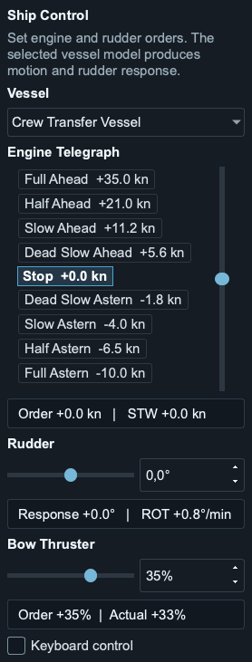

# Maritime Ship Simulator

[User Guide (PDF)](docs/manual/Maritime_Ship_Simulator_User_Guide_2.3.0.pdf) |
[User Guide (Word)](docs/manual/Maritime_Ship_Simulator_User_Guide_2.3.0.docx) |
[Installation](INSTALLATION.md) |
[Releases](https://github.com/p2htf65ggk-bit/maritime-ship-simulator/releases) |
[Report a bug](https://github.com/p2htf65ggk-bit/maritime-ship-simulator/issues/new/choose)

Current source snapshot: **2.3.0**, licensed under the **Mozilla Public License 2.0** for the
project's original code. Third-party software and chart data retain their own
licenses; see [THIRD_PARTY_NOTICES.md](THIRD_PARTY_NOTICES.md).

A desktop ship and sensor simulator for training, demonstrations, integration
and test benches. It generates AIS and IEC 61162/NMEA-style data through UDP,
TCP and serial interfaces. It also provides route following, synthetic traffic,
fault injection, offline maps/ENCs and optional online Google 3D views.

**Not certified navigation equipment. Do not use it for real navigation or as
a safety-critical source of vessel, traffic, chart or collision information.**

## Capabilities

| Area | Included |
| --- | --- |
| Ship handling | Vessel profiles, engine telegraph, rudder, speed-dependent tunnel bow thruster |
| Control modes | Manual sensor values, Ship Control, Track Control and external inputs |
| External control | Independent rudder, engine and thruster sources with fallback behavior |
| Traffic | Generated, live and editable synthetic AIS; encounter scenarios |
| Protocols | IEC 61162/NMEA-style output through UDP, TCP and serial interfaces |
| Maps | Online 2D maps, offline Protomaps areas and experimental S57/NOAA ENCs |
| Visual view | Optional online Google 3D maps with simulator overlays |
| Test scenarios | Sensor noise, fault injection, environment values and saved configurations |

Local simulation and local protocol output do not require Internet or a Google
API key. Download/import detailed charts before going offline. See the
[offline workflow](docs/v2_user_guide.md) and [provider privacy notes](PRIVACY.md).

<details>
<summary>Ship Control panel in 2.3.0</summary>



</details>

## Releases and support

The public project is maintained by **Pascal Göllnitz**. Version labels are not
a claim of exhaustive platform/hardware qualification; see
[validation](docs/VALIDATION.md) and the release notes.
This source tree is **2.3.0**, the public baseline with bow-thruster and external-input controls.
Installers will be attached to the corresponding GitHub Releases after their
publication checks. Existing private build archives are not public source packages.

For application downloads rather than development, see
[Installation](INSTALLATION.md), [known limitations](KNOWN_LIMITATIONS.md) and
[release licensing](docs/RELEASE_LICENSING.md). New installers must be built from
the matching public snapshot. Native validation and the bundled dependency/notice
review must be complete before public release. Older private packages are not
substitutes for this version.

Maintenance is on a best-effort basis. Issues and pull requests are welcome,
but response times, acceptance of contributions and future releases are not
guaranteed. No paid support or service-level agreement is implied.

## Get started

Use Python **3.12 or newer**; Python 3.13 is the reference development version.
Run commands from the extracted project root. Git is optional for running or
building this snapshot. Internet is needed to install dependencies unless an
appropriate local wheelhouse is available.

macOS / Linux:

```bash
python3 -m venv .venv
.venv/bin/python -m pip install -r requirements-v2-release.txt
.venv/bin/python run_v2.py
```

Windows PowerShell:

```powershell
py -3.13 -m venv .venv
.\.venv\Scripts\python.exe -m pip install -r requirements-v2-release.txt
.\.venv\Scripts\python.exe run_v2.py
```

On Linux, Qt needs system display/OpenGL libraries. The Ubuntu release scripts
and runtime launcher contain dependency checks. Python packages alone cannot
provide a working desktop display server.

This is a source-tree application, not a published PyPI package. An editable
`pip install -e .` is not required or supported by this snapshot.

## Where to start in the code

| Location | Responsibility |
| --- | --- |
| `run_v2.py` | Application startup and diagnostics |
| `src/maritime_simulator/domain/` | State, snapshots, commands and vessel profiles |
| `src/maritime_simulator/application/` | Command ownership, AIS and configuration |
| `src/maritime_simulator/simulation/` | Clock, dynamics, steering, routes and prediction |
| `src/maritime_simulator/protocols/` | Sensor projection, sentence encoding and scheduling |
| `src/maritime_simulator/transport/` | UDP/TCP/serial and online input adapters |
| `src/maritime_simulator/visual/` | Offline maps, S57, water masks and display payloads |
| `src/maritime_simulator/ui/` | Current desktop UI and lifecycle-managed workers |
| `ui/` | Small, still-required shared module set and browser resources |
| `tests/v2/`, `tests/fixtures/` | Current regression suite and test data |
| `scripts/` | Build, validation, benchmark and browser verification tools |

The root `ui/` folder is intentional. Track Control still uses `ui.simulation`
behind an adapter; the map and instrument renderer are also shared modules.
They are current dependencies, not a second runnable application. Do not delete
or rename them without updating their consumers and tests. See
[architecture](docs/v2_architecture.md).

## Test and build

```bash
.venv/bin/python scripts/prebuild_v2.py --profile quick
.venv/bin/python scripts/prebuild_v2.py --profile full
```

On Windows, substitute `.\.venv\Scripts\python.exe`. The full gate runs the V2
tests, 60 checked-in Track baseline cases and performance/retained-memory checks.
Tests use temporary configurations and local loopback transports. Hardware
serial, real provider authentication and native GPU behavior need separate tests.

[Testing and development](CONTRIBUTING.md) explains focused checks and optional
browser tooling. [Build instructions](docs/v2_release_scripts.md) cover Windows,
macOS, Ubuntu and the dedicated Ubuntu 22.04 compatibility build. Build natively
on each target OS; the scripts default to unsigned packages and recognize RC
versions as prereleases.

## Configuration and offline operation

Operator settings do not belong in this source tree. Defaults are stored under:

- Windows: `%APPDATA%\Ship Simulator\v2`
- macOS: `~/Library/Application Support/Ship Simulator/v2`
- Linux: `${XDG_CONFIG_HOME:-~/.config}/Ship Simulator/v2`

`MARITIME_SIMULATOR_V2_CONFIG_DIR` overrides that location, which is useful for
an isolated development profile. The source contains no Google/AIS/provider keys,
saved operator settings, downloaded chart library or Google imagery.

Local simulation and local output work without Internet. The bundled schematic
coastline is available offline. Detailed map areas and ENC cells must first be
downloaded/imported through Settings. Google 3D and new Live AIS/weather data are
online services with separate credentials, terms and possible charges.

See the [User Guide](docs/v2_user_guide.md), [3D notes](docs/v2_1_forward_view.md)
and [data/licensing inventory](THIRD_PARTY_NOTICES.md).

## Snapshot contents

Only the current application, its required shared code, data and development
tools are included. Repository history begins with the clean 2.3.0 snapshot;
earlier private development history has not been imported. Application binaries,
virtual environments and installation-specific integration guides are not part
of this repository.
`DEVELOPER_SOURCE_MANIFEST.json` records the exported scope and reviewed
export-only adjustments; `SOURCE_SHA256SUMS` covers that original archive's
files at the initial commit. Later documentation changes are recorded in Git.
See [source provenance](docs/SOURCE_PROVENANCE.md) to verify the baseline.

The MPL 2.0 license is in `LICENSE`. `FREEWARE_LICENSE.txt` contains the same MPL
text under the filename expected by existing application packaging code. It
does not introduce separate Freeware restrictions. Original source files carry
`SPDX-License-Identifier: MPL-2.0`; upstream code/data keeps its own notices.

MPL permits commercial use and combination with separate proprietary modules.
When distributing modified MPL-covered code, make its source available to
recipients under MPL and retain the required notices. Separate files containing
no MPL-covered code may remain proprietary. Private/internal modifications do
not require publication. See the full license and
[Mozilla FAQ](https://www.mozilla.org/en-US/MPL/2.0/FAQ/); this summary does not
replace those terms or the licenses of dependencies.

Optional support: [Maritime Knowledge Bites](https://mybook.to/MaritimeKnowledgeBites).
